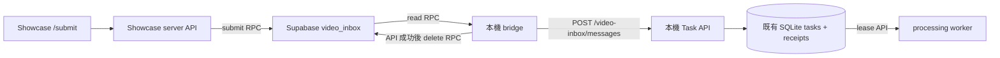

# Showcase 影片收件與本機入列

此流程讓使用者在 Showcase `/submit` 輸入 YouTube 網址，本機關機時先由 Supabase Queue 保存訊息；本機恢復後由 bridge 接收。Supabase Queue 是跨網路的暫存交件管道，既有 SQLite 是本機任務與 receipt 的持久層，影片處理仍由原 processing worker 執行。網站不提供雲端進度或摘要結果回寫。

## 模組責任與資料流

| 模組 | 責任與邊界 |
| --- | --- |
| Showcase `/submit` | 產生並保存待確認的 `submission_id`，讓回應遺失時可用同一 ID 重試；收集個人提交碼。 |
| Showcase server API | 驗證提交碼、精確 Origin 與 YouTube URL；用 server-only submit token 呼叫 Supabase RPC。 |
| Supabase pgmq | 在 `video_inbox` queue 暫存網址與 ID；read 期間以 visibility timeout 隱藏訊息，delete 才確認移除。 |
| 本機 bridge | 用 receiver token 領取 Queue 訊息，透過 HTTP 交給本機 Task API；收到明確成功結果後才刪除雲端訊息，不開啟 SQLite。 |
| 本機 Task API | 驗證 worker token，決定接受或隔離；在原有 SQLite 中交易式建立／重用任務與 receipt。 |
| processing worker | 透過原有 HTTP lease API claim 本機 Pending 任務，執行下載、轉錄、摘要與結果儲存。 |

既有 `POST /tasks` 實作 URL 去重與快取政策，但沒有 submission receipt 契約。雲端訊息由專用 `POST /video-inbox/messages` 交接，讓任務與 receipt 一起提交。這個邊界讓 bridge 不需要 `VIDEO_INBOX_DB_PATH`，也不需與 API 共用 SQLite volume；收件 API 仍使用原本的 `data/tasks.db`。

## 提交與權限

瀏覽器第一次提交前建立 UUID，將 UUID 與網址寫入 `localStorage`。回應未確認、重新整理或重試會沿用同一 ID；成功後才清除。若無法保存待確認資料，提交不會送出。個人提交碼只在表單與請求 header 使用，不寫入 `localStorage`。Showcase server 將網址正規化為標準 YouTube watch URL，再以 `video_inbox_submit` RPC 發送 `version=1`、`submission_id` 與 `url`。

Supabase migration 建立 pgmq queue、私有 `video_inbox_private.credentials` 雜湊表，以及 submit/read/delete 三個 `SECURITY DEFINER` RPC。submit token 只能送入，receiver token 只能領取與刪除；兩者明文分別只放在 Showcase server 和本機。RPC 驗證 `x-video-inbox-key`，不把原始 `pgmq` 或私有憑證表暴露給 Data API。瀏覽器個人提交碼是第三組獨立憑證。Migration 遇到不安全的既有 queue grants 會回滾，操作指引見[收件匣手冊](../../docs/video-inbox.md)。

## 本機接收、去重與隔離

bridge 啟動後立即 read；每次讀一筆，visibility 預設 60 秒。單輪最多 20 筆，有工作時快速續讀，空閒預設等待 300 秒；錯誤以 5 秒起算、最多 300 秒退避。本機 API 呼叫沿用 `TASK_API_BASE_URL` 與 `PROCESSING_WORKER_TOKEN`（或既有 admin token fallback），不直接操作資料庫。

Task API 先驗證 `X-Worker-Token`。有效 payload 由 SQLite adapter 在 `BEGIN IMMEDIATE` 中檢查 receipt，沿用 `create_task_record` 的 URL 去重／Completed TTL 政策，並將 task 與 receipt 同交易提交。相同 `submission_id` 重送可找到同一 task；同 ID 換網址或無效 payload 寫入本機 `video_inbox_quarantine`。API 對成功接受或隔離回明確 outcome；SQLite 寫入失敗回 503，bridge 不刪除雲端訊息。

雲端 Queue 的 visibility timeout 只涵蓋短暫交件，沒有等待影片處理完畢。既有 processing worker 取得本機 Pending task 後使用自己的 lease／heartbeat 流程；它不讀 Supabase Queue。

## 故障復原

| 斷點 | 後續行為 |
| --- | --- |
| Showcase 送出後回應遺失 | 瀏覽器保留 UUID 與網址，用同一 ID 重試；Queue 可能出現重送訊息。 |
| 本機 API 尚未提交即斷線或回錯 | bridge 保留雲端訊息；visibility 到期後再領。 |
| API 已提交但回應遺失，或 bridge 刪除前中斷 | 雲端重送，SQLite receipt 命中，不重複建立 task。 |
| payload 無效或同 ID 換網址 | API 先寫 quarantine；確認成功後 bridge 才刪雲端訊息。 |
| Supabase、API 或網路暫時失敗 | bridge 記錄安全的錯誤類別與 HTTP status，退避後重試；不記錄 token、網址或原始上游 body。 |

收件匣不使用短 TTL 自動清除待領訊息，正常確認只 delete、不 archive。備份本機 SQLite 時需保留 receipts；只還原 tasks 會失去跨雲端重送的去重依據。這些是目前程式的資料邊界；實際 Supabase 專案、部署設定及雲端端到端行為仍需依[操作手冊](../../docs/video-inbox.md)驗收。

## 驗證與延伸

本機 integration tests 覆蓋 API worker token、收件去重、無效訊息隔離、SQLite rollback 與刪除失敗後重送；HTTP adapter 測試確認非成功 outcome 不會刪 Queue。SQL 測試使用隔離 pgmq container 驗證 RPC 權限、visibility、delete 與 token 輪替。這些檢查不代表已驗證託管 Supabase gateway 或實際部署。

延伸閱讀：[HTTP API 契約](../interfaces/http-api-and-clients.md)、[任務生命週期](task-lifecycle.md)、[任務持久化](../persistence/task-and-result-storage.md)、[設定與部署](../operations/configuration-and-deployment.md)。
